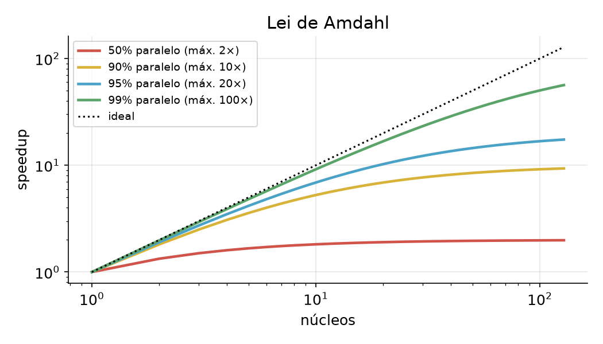
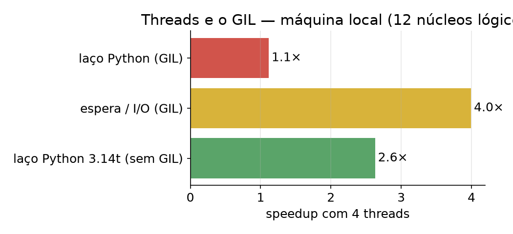
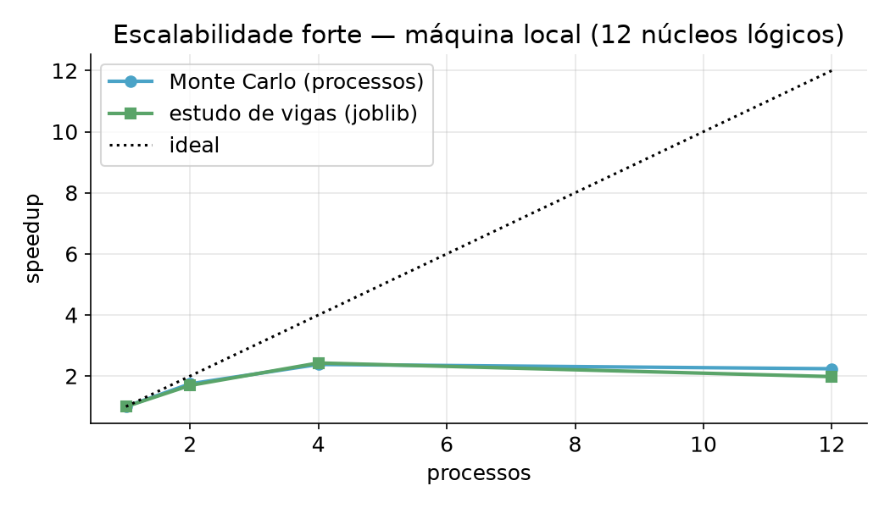
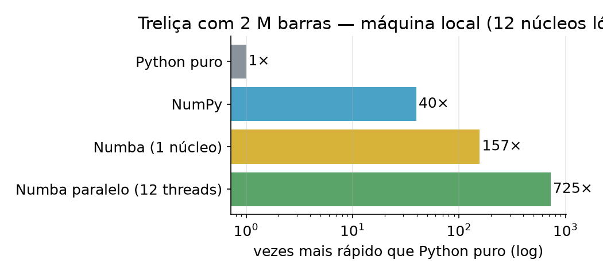

# Aula 1 — Paralelismo e desempenho na CPU
## Computação de Alto Desempenho em Python para Engenharia Civil

3h30 · notebook: `notebooks/Aula1_CPU.ipynb` (Colab)
Vídeos curtos de cada bloco: **lucaswastaken.github.io/Openhardware-hpc**

---

# Roteiro

| Tempo | Bloco |
|---|---|
| 0:00–0:20 | 1. Medir antes de otimizar |
| 0:20–0:50 | 2. Speedup, eficiência, Amdahl e Gustafson |
| 0:50–1:30 | 3. Threads × processos, GIL e Python sem GIL |
| 1:30–1:45 | ☕ |
| 1:45–2:30 | 4. Vetorização, BLAS e `joblib` |
| 2:30–3:10 | 5. Numba |
| 3:10–3:30 | 6. Exercício guiado e lista |

---

# Engenharia = muitas contas independentes

- casos de carga · posições de um veículo · amostras de Monte Carlo
- elementos de uma malha · vigas de um estudo paramétrico · pontos de integração

**Paralelismo de dados:** a mesma conta em dados diferentes → pode ser feita ao mesmo tempo.

---

# 1. Meça antes de otimizar

| Ferramenta | Responde |
|---|---|
| `time.perf_counter()` | quanto tempo levou? |
| `%timeit` | quanto, com repetição e variação? |
| `cProfile` | quais **funções** gastam o tempo? |
| `line_profiler` (`%lprun`) | quais **linhas**? |

Envoltória de momentos (1500 seções × 1500 posições): o perfil mostra **2,25 milhões** de chamadas → vetorizar com NumPy: **~10× mais rápido no mesmo núcleo**.

> Primeiro use bem **um** núcleo. Depois, vários.

---

# 2. Speedup e eficiência

$$S(p) = \frac{T_1}{T_p} \qquad E(p) = \frac{S(p)}{p}$$

- **Escalabilidade forte:** mesmo problema, mais núcleos → Amdahl
- **Escalabilidade fraca:** problema cresce com os núcleos → Gustafson
- **Karp–Flatt** (fração serial estimada): $e = \dfrac{1/S - 1/p}{1 - 1/p}$

---

# Lei de Amdahl



$$S(p) = \frac{1}{(1-f) + f/p}$$

Com 90% paralelo, **nunca** passa de 10×.

Antes de comprar núcleos: **reduza a parte serial**.

---

# 3. Threads × processos

| | Threads | Processos |
|---|---|---|
| Memória | compartilhada | separada (dados copiados) |
| Custo de criar | baixo | alto |
| Laço Python puro | ❌ GIL | ✅ |
| Espera (I/O), NumPy | ✅ | ✅ |

**GIL:** só uma thread executa bytecode Python por vez.
**Python 3.13t/3.14t:** versão *free-threaded*, sem GIL (oficial no 3.14, PEP 779).

---

# Medido na aula



---

# Processos: Monte Carlo para confiabilidade

$P_f = P(R < S)$ · $R$ lognormal (resistência), $S$ Gumbel (solicitação máxima anual)

- 160 milhões de amostras em 64 lotes **independentes**, cada um com sua semente
- `ProcessPoolExecutor(max_workers=p).map(lote_falhas, tarefas)`
- Windows/macOS criam processos do zero (*spawn*): o *worker* fica num arquivo `.py`

---

# Escalabilidade medida



<span class="pequeno">No Colab gratuito há 2 núcleos: o teto é ~2×.</span>

---

# 4. BLAS: você já usa vários núcleos

```python
from threadpoolctl import threadpool_limits
with threadpool_limits(limits=1):
    A @ A          # 1 thread
A @ A              # todas as threads do OpenBLAS/MKL
```

**Sobreassinatura:** 4 processos × 4 threads de BLAS em 4 núcleos → mais lento.
`parallel_config(backend="loky", inner_max_num_threads=1)`

---

# `joblib`: estudo paramétrico

```python
from joblib import Parallel, delayed
res = Parallel(n_jobs=-1)(delayed(verifica)(c) for c in casos)
```

Vão × altura × carga → análise por MEF + verificação $L/250$ → **altura mínima por vão**.

---

# 5. Numba

```python
@njit(parallel=True, fastmath=True, cache=True)
def rigidez(xy, conect, EA):
    k = np.empty((n, 4, 4))
    for e in prange(n):        # cada barra numa thread
        ...
```

- compila na 1ª chamada (LLVM) · `cache=True` guarda
- `prange` exige iterações **independentes**; `+=` e `max` viram reduções

---

# Treliça com 2 milhões de barras



---

# 6. Exercício guiado

1 milhão de seções: $\sigma = |N|/A + |M|/W$ → quantas passam de $f_y$ e qual a maior tensão?

Acelere a versão em Python puro e **meça o speedup**.

Depois: escolha **um** exercício de `exercicios/lista.md` e use o **modelo de relatório**.

---

# Resumo

| Ferramenta | Quando | Cuidado |
|---|---|---|
| NumPy | arrays inteiros | temporários grandes |
| BLAS | álgebra linear densa | já é paralelo |
| processos / `joblib` | tarefas independentes e pesadas | custo de criar e copiar |
| Numba | laços com lógica | compilação; independência |
| threads | I/O; Python 3.14t | GIL no Python tradicional |

**Próxima aula:** GPU — e CPU e GPU ainda são mundos separados?
