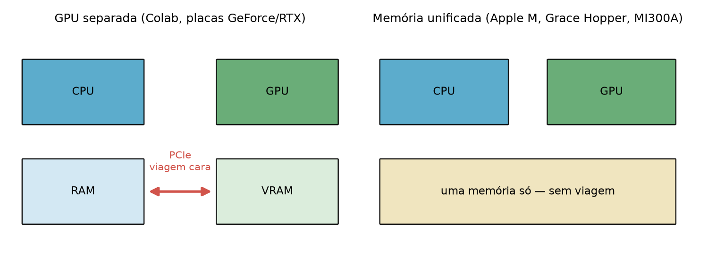
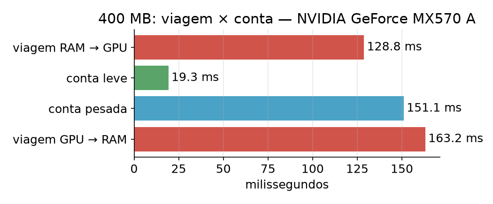
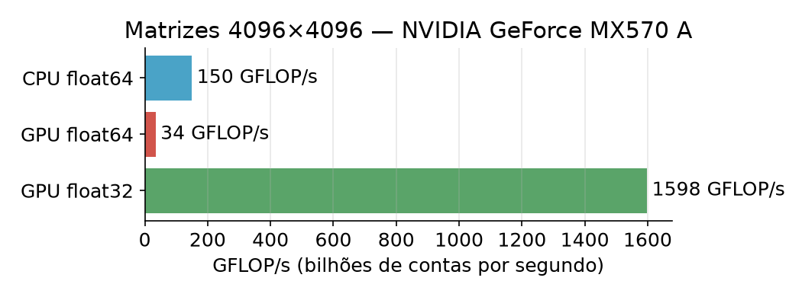
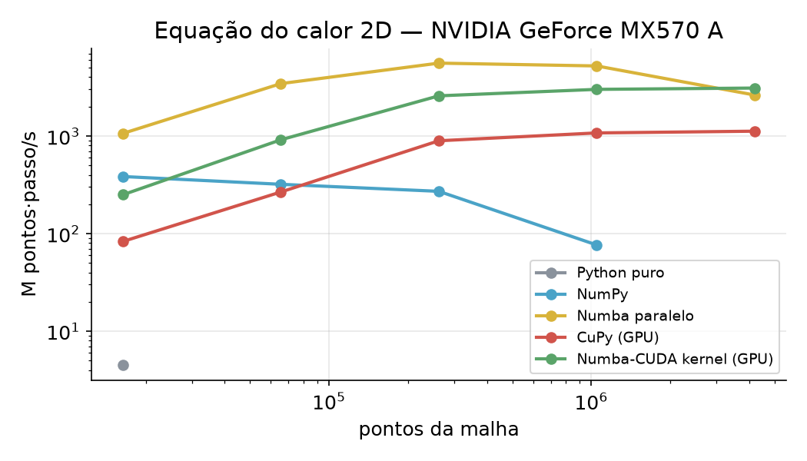
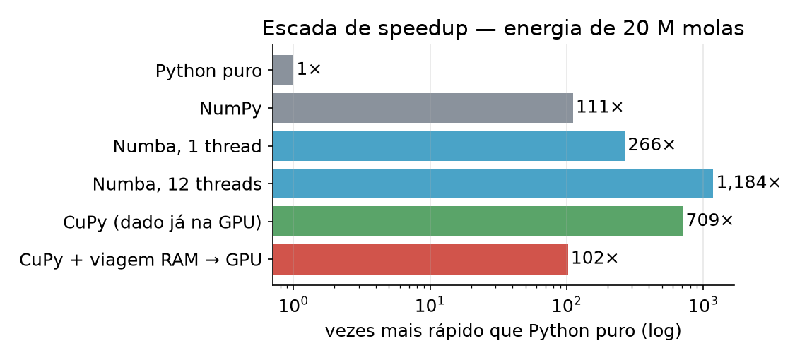

# Aula 2 — GPU na prática
## Computação de Alto Desempenho em Python para Engenharia Civil

3h30 · notebook: `notebooks/Aula2_GPU.ipynb` (Colab, **T4 GPU**)
Vídeos curtos de cada bloco: **lucaswastaken.github.io/Openhardware-hpc**

---

# Ao final da aula você vai saber

1. quando uma GPU **ajuda** — e quando **atrapalha**
2. por que **onde o dado mora** decide quase tudo
3. levar código NumPy para a GPU com **CuPy** (`np` → `cp`)
4. medir certo e comparar CPU × GPU no **seu** exercício

| Tempo | Bloco |
|---|---|
| 0:00–0:20 | 1. Por que GPU? |
| 0:20–0:50 | 2. Dois mundos: RAM e memória da GPU |
| 0:50–1:30 | 3. CuPy em 3 passos |
| 1:45–2:45 | 4. Projeto: laje em incêndio |
| 2:45–3:30 | 5. Seu exercício na GPU · 6. Quando usar GPU |

---

# 1. Por que GPU? Milhares de operários

| CPU | GPU |
|---|---|
| **8 engenheiros** experientes | **2 500 operários** |
| cada um resolve qualquer coisa, com decisões diferentes | todos fazem **a mesma tarefa ao mesmo tempo**, cada um no seu pedaço |
| montar a malha, decidir o próximo passo | tensão em 1 milhão de pontos, temperatura em cada nó, Monte Carlo |

**A pergunta-chave:** o meu problema tem *muitos dados* recebendo *a mesma conta*?

---

# 2. Dois mundos: a viagem dos dados



Na GPU separada (o Colab), os dados **viajam** pelo cabo PCIe antes e depois da conta.

---

# Medido: a viagem custa mais que a conta



> **Regra de ouro:** leve os dados **uma vez**, faça **todas** as contas na GPU, traga só o resultado.

---

# Memória unificada: o depósito dentro da obra

| Máquina | Exemplos | Viagem? |
|---|---|---|
| GPU separada | Colab (T4), GeForce/RTX, maioria dos clusters | sim |
| Memória unificada | Apple M1–M5, Grace Hopper, DGX Spark, AMD MI300A | não |

**Muda:** acaba a viagem; código mais simples.
**Não muda:** continua precisando de **muitos dados com a mesma conta** e de memória rápida.

---

# 3. CuPy em 3 passos

| Passo | Código |
|---|---|
| **1. Leve** os dados, uma vez | `x = cp.asarray(x_ram)` |
| **2. Calcule** trocando `np` por `cp` | `cp.sqrt(...)`, `cp.sum(...)`, `A @ B` |
| **3. Traga** só o resultado | `cp.asnumpy(y)` · `float(total)` |

**Para medir:** aqueça (1ª chamada é lenta) e **sincronize** (`cp.cuda.Device().synchronize()`).

```python
def von_mises(sx, sy, txy):
    xp = cp.get_array_module(sx)       # np ou cp, conforme onde estão os dados
    return xp.sqrt(sx**2 - sx*sy + sy**2 + 3*txy**2)
```

---

# O erro nº 1: esquecer de sincronizar

A CPU **pede** a conta e segue em frente. Sem esperar a GPU, você mede só o **pedido**.

- sem sincronizar: *"a GPU fez em 0,02 ms!"* ← errado
- sincronizando: o tempo real

> Se um resultado de GPU parece bom demais, **pergunte se sincronizou**. A IA erra isso com frequência.

---

# Onde a GPU brilha: matrizes (e `float32`)



Muitas contas por número → a GPU dispara. Em placas comuns, `float32` é **muito** mais rápido que `float64` — confira se 7 dígitos bastam.

---

# 4. Projeto: laje em incêndio

Corte 20 × 20 cm, face de baixo a **600 °C**. Cada ponto vira um pouco a **média dos 4 vizinhos**, a cada passo.

```python
def simula(T, passos):                   # a MESMA função na CPU e na GPU
    xp = cp.get_array_module(T)
    ...                                  # T + 0,24 × (vizinhos − 4·T)
```

`laje_inicial(n)` → CPU · `laje_inicial(n, cp)` → GPU. Quem decide é **onde está o array**.

---

# Quem é mais rápido? Depende do tamanho



<span class="pequeno">Malha pequena: a GPU não ganha. Malha grande: ganha, porque os dados ficam parados na GPU por 300 passos. Numba na CPU é adversário forte — meça no seu hardware.</span>

---

# 5. O seu exercício na GPU: a escada



<span class="pequeno">Mesmo problema da lista (energia de 20 M molas). Contando a viagem RAM → GPU, a GPU perde para o Numba: a conta é leve e feita uma vez só.</span>

---

# Usando IA sem se perder

> *"Tenho esta função [cole a serial]. Reescreva com CuPy, mantendo os dados na GPU. Mostre como medir (aquecer e sincronizar) e como conferir com a original."*

Antes de acreditar, confira:
1. ✅ o resultado bate com a serial
2. ✅ aqueceu antes de medir
3. ✅ sincronizou antes de parar o relógio
4. ✅ sabe se a viagem RAM → GPU está no tempo

---

# 6. Quando usar GPU?

1. **Muitos dados, mesma conta?**
2. **Os dados podem ficar na GPU** por muitos passos?
3. **Muita conta por número?** (matrizes, simulação, Monte Carlo)
4. **`float32` basta?**
5. **Mediu direito?**

| Ferramenta | Quando |
|---|---|
| **CuPy** ⭐ | `np` → `cp`: arrays, álgebra linear, FFT |
| Numba-CUDA | sua própria função por operário (kernel) |
| PyTorch / JAX | otimização, derivadas automáticas |
| RAPIDS cuDF | tabelas grandes (pandas na GPU) |

---

# Exercícios

- `exercicios/lista.md` — escolha **um** exercício e **um** caminho: **CPU com Numba** (recomendado) ou **GPU com CuPy**
- Só **escalabilidade forte**: CPU varia as threads; GPU monta a escada
- `exercicios/modelo_relatorio.ipynb` — mede, confere e desenha; troque só as células ✏️
- `exercicios/INSTALACAO.md` — Colab ou seu computador
- Vídeos 11–14: relatório, exemplo Numba, exemplo CuPy, IA
