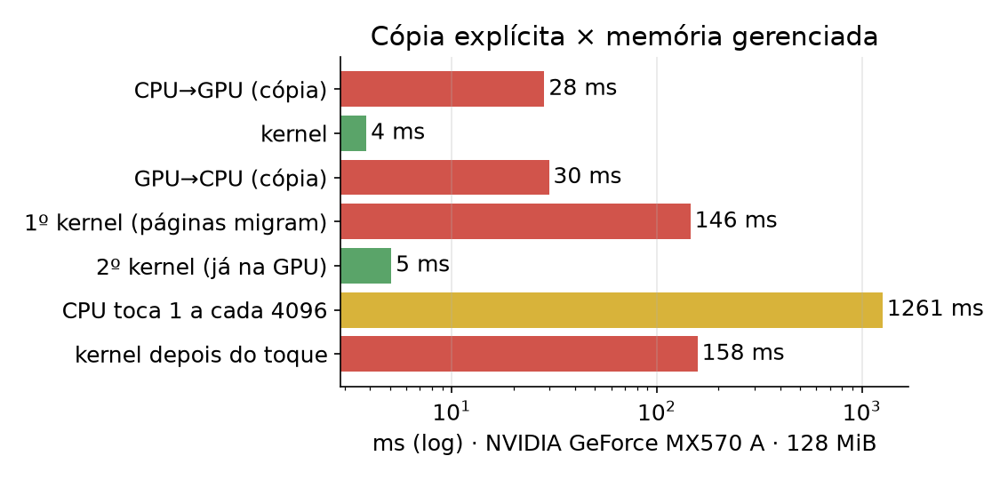
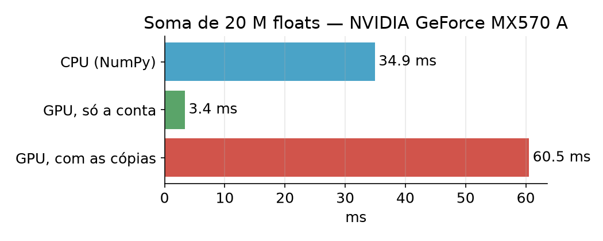

# Aula 2 — GPU: paralelismo massivo
## Computação de Alto Desempenho em Python para Engenharia Civil

3h30 · notebook: `notebooks/Aula2_GPU.ipynb` (Colab, **T4 GPU**)
Vídeos curtos de cada bloco: **lucaswastaken.github.io/Openhardware-hpc**

---

# Roteiro

| Tempo | Bloco |
|---|---|
| 0:00–0:25 | 1. CPU × GPU |
| 0:25–0:50 | 2. CPU e GPU ainda são mundos separados? |
| 0:50–1:05 | 3. CuPy e como medir direito |
| 1:05–1:45 | 4. Kernels: grid, block, thread |
| 1:45–2:00 | ☕ |
| 2:00–3:00 | 5. Projeto: equação do calor numa laje |
| 3:00–3:30 | 6. Quando usar GPU? Exercícios |

---

# 1. CPU × GPU

| | CPU | GPU |
|---|---|---|
| Núcleos | poucos, complexos | milhares, simples |
| Otimizada para | latência | vazão |
| Execução | independente | *warps* de 32 threads, mesma instrução (SIMT) |
| Memória | cache grande, ~50–100 GB/s | ~300–3000 GB/s |

8 engenheiros sêniores × uma obra com 2 500 operários.

---

# Warps e divergência

- 32 threads executam **a mesma instrução**, cada uma com seu dado
- `if` com caminhos diferentes dentro do warp → os dois caminhos rodam em sequência
- GPU gosta de **contas uniformes** em **muitos dados**

---

# 2. CPU e GPU ainda são mundos separados?

| Modelo | Exemplos | Cópia? |
|---|---|---|
| GPU discreta + PCIe | T4 (Colab), GeForce/RTX, clusters | sim (ou migração de páginas) |
| CPU+GPU coerentes, link rápido | Grace Hopper / Grace Blackwell (NVLink-C2C ~900 GB/s), DGX Spark | não precisa |
| Memória física única | Apple M1–M5, AMD MI300A, Ryzen AI Max, Lunar Lake | não existe |

---

# O que muda e o que não muda

**Muda:** sem cópias e sem o "pedágio" do PCIe; modelos grandes numa memória só; código mais simples.

**Não muda:**
- milhares de núcleos simples em warps → exige **paralelismo de dados**
- **largura de banda e localidade** continuam mandando
- na GPU discreta, a memória gerenciada do CUDA é uma **ilusão de software**: páginas migram pelo PCIe

> A pergunta mudou: de *"quanto custa copiar?"* para *"onde o dado mora, e quem o processa melhor?"*

---

# Medido: cópia × memória gerenciada



<span class="pequeno">No Colab (Linux) há migração sob demanda e `prefetch`; no Windows, migra tudo a cada kernel.</span>

---

# 3. CuPy: três regras para medir

1. **Aquecer** (1ª chamada compila e aloca)
2. **Sincronizar** — `cp.cuda.Device().synchronize()` (a GPU é assíncrona)
3. **Separar** cálculo de transferência — `cupyx.profiler.benchmark`



---

# Contas por byte

- soma de vetores: 1 conta / 12 bytes → **limitada pela memória**
- matmul: $2n^3$ contas sobre $3n^2$ números → **limitada pelo cálculo**


`float64` em GPUs de consumo (T4, GeForce): muito mais lento.

---

# 4. Kernels

```python
@cuda.jit
def escala(x, a):
    i = cuda.grid(1)           # blockIdx.x * blockDim.x + threadIdx.x
    if i < x.size:
        x[i] = a * x[i] + 1.0

escala[(n + 255) // 256, 256](x_gpu, 2.0)     # [grade, bloco]
```

- `cp.ElementwiseKernel`: uma conta por elemento, em C, sem temporários (von Mises)
- Numba-CUDA: laços e lógica por thread (Monte Carlo com `xoroshiro128p`)

---

# 5. Projeto: equação do calor numa laje

$$T^{n+1}_{i,j} = T^n_{i,j} + r\,(T_{i\pm1,j} + T_{i,j\pm1} - 4T_{i,j}), \quad r \le 0{,}25$$

Uma função para CPU **e** GPU (Array API):

```python
def simula(T, passos):
    xp = array_namespace(T)          # numpy ou cupy
    ...
```

Versões: Python puro → NumPy → Numba paralelo → CuPy → kernel 2D Numba-CUDA.

---

# Vazão por tamanho de malha


<span class="pequeno">Problema limitado pela memória: ganha quem tem mais largura de banda. Meça no seu hardware.</span>

---

# 6. Quando usar GPU?

1. Há **paralelismo de dados**?
2. **Muita conta por byte**? Se não, o dado já está na GPU?
3. **Onde o dado mora?** Faça muitos passos lá antes de trazer de volta.
4. `float32` basta?
5. Mediu direito? (aquecer, sincronizar, separar, repetir)

| Ferramenta | Use para |
|---|---|
| CuPy | `np` → `cp` |
| `ElementwiseKernel` / `RawKernel` | conta por elemento |
| Numba-CUDA | kernels em Python |
| Array API | mesmo código CPU/GPU |
| PyTorch / JAX | cálculo + derivadas automáticas |

---

# Exercícios

- `exercicios/lista.md`: escolha **um** exercício e **uma** tecnologia
- `exercicios/modelo_relatorio.ipynb`: mede, confere e desenha os gráficos
- Vídeos 11–14: como fazer o relatório e exemplos resolvidos (parecidos, não iguais)
